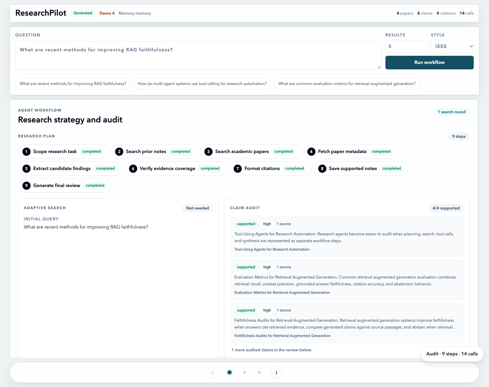
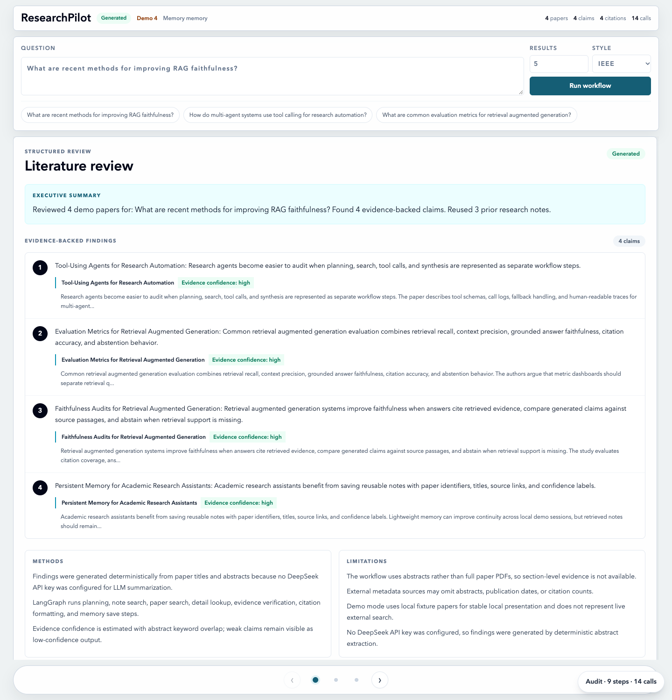
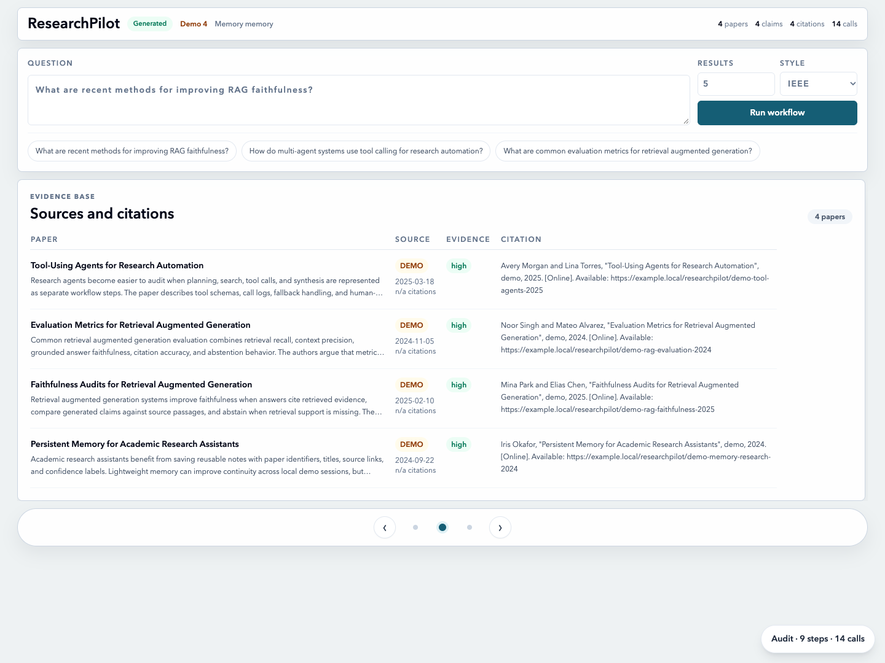
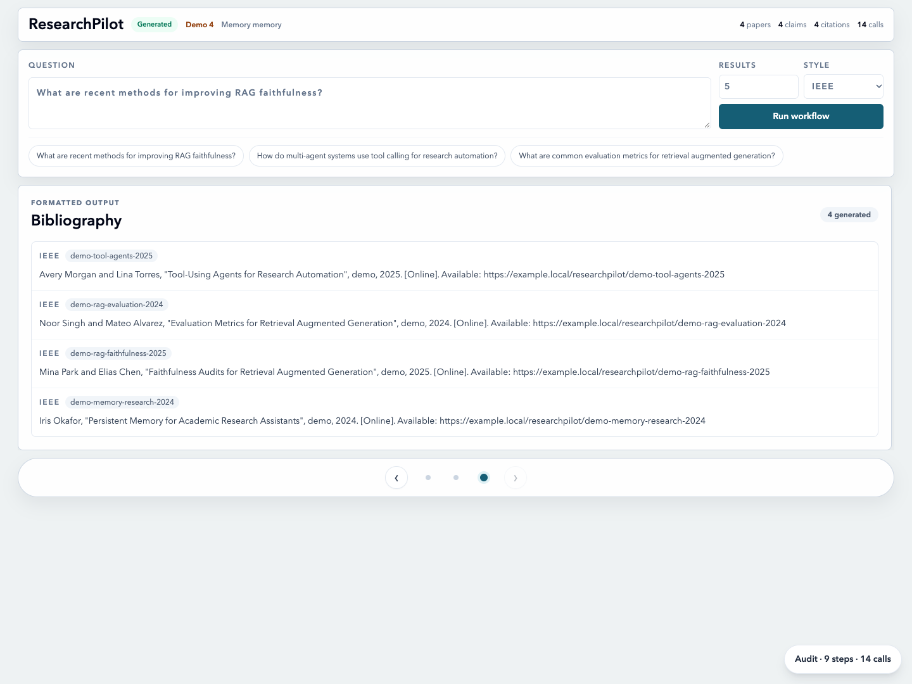
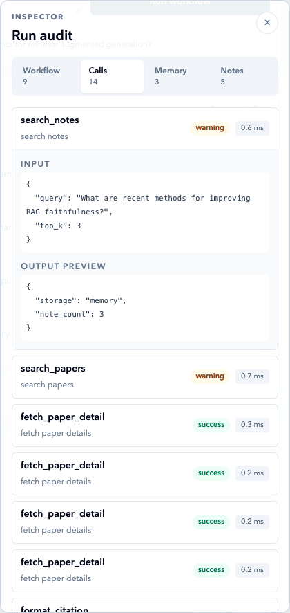
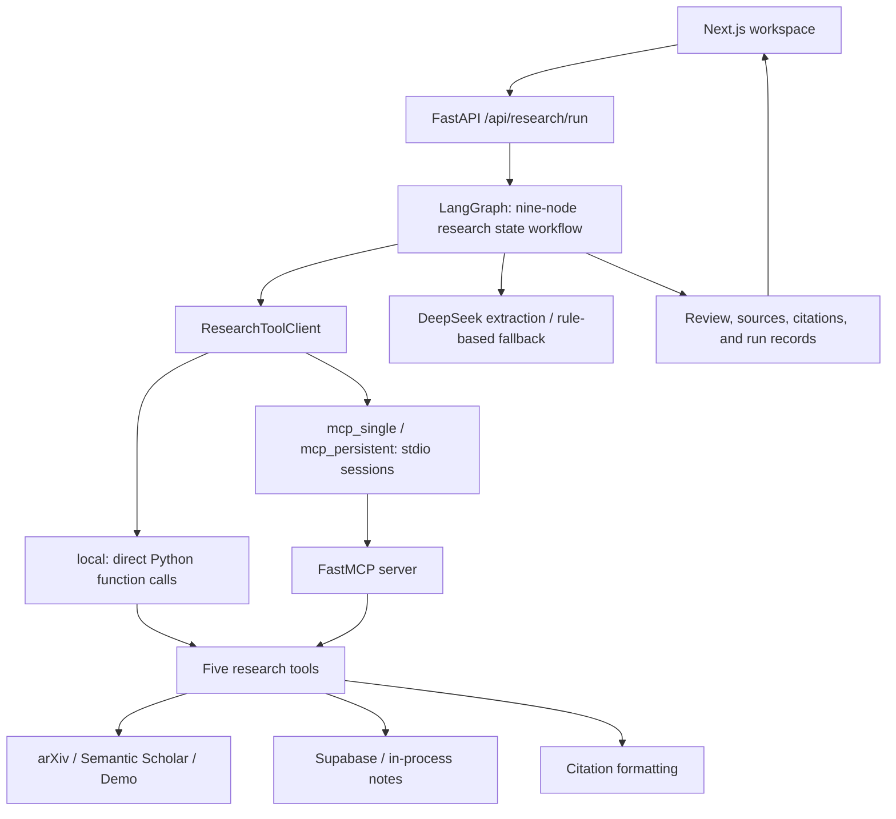

# ResearchPilot

[简体中文](README.md) | **English**

[](https://github.com/AZ123IT/ResearchPilot/actions/workflows/ci.yml)


[](LICENSE)

**An academic research agent workflow built on LangGraph and MCP. Start from a research question, then search papers, extract findings, link evidence, and format citations, with every tool call and fallback recorded.**

ResearchPilot searches arXiv and Semantic Scholar, uses DeepSeek to extract candidate findings from abstracts, links each finding to a source paper and abstract snippet, formats IEEE / APA / BibTeX citations, and shows the full run (steps, tool calls, latency, warnings, fallbacks) in a Next.js workspace.

[Screenshots](#screenshots) · [Architecture](#architecture) · [Run Locally](#run-locally) · [Architecture details (Chinese)](docs/ARCHITECTURE.md) · [Validation record (Chinese)](docs/VALIDATION.md)

## Highlights

- **9-node LangGraph state workflow**: plan → search notes → search papers → fetch metadata → extract findings → verify evidence → format citations → save notes → generate review, with one adaptive search round when results are insufficient.
- **Research MCP server** built with the MCP Python SDK / FastMCP, exposing `search_papers`, `fetch_paper_detail`, `search_notes`, `save_to_notes`, and `format_citation`. The backend's tool adapter supports **local calls, per-call MCP stdio, and a persistent MCP session**.
- **Multi-source retrieval with an evidence trail**: fielded arXiv topic-term queries sorted by relevance, Semantic Scholar as a supplement, and every finding linked to a source paper, abstract snippet, and match level.
- **Structured LLM output**: DeepSeek runs in JSON mode; non-JSON replies are cleaned of numbering, markdown, and lead-in lines.
- **Observability and graceful degradation**: step traces, tool call logs, run audit, and warnings; search caching, deterministic fallback when DeepSeek fails, local fallback when MCP fails, and in-memory notes when Supabase is unavailable.
- **Tests and CI**: 39 pytest cases cover workflow routing, tool calls, parsing, and each fallback path; GitHub Actions runs pytest, the TypeScript typecheck, and a Next.js production build.

## Screenshots

These screenshots come from **demo mode** (bundled sample papers, rule-based extraction, no API keys needed) and show the interaction and execution flow.



<details>
<summary>Show the review, sources, references, and tool call audit</summary>

### Structured Review

Findings appear with source abstracts and match levels. The methods section states whether the model or the rule-based fallback produced them.



### Paper Sources



### References



### Tool Call Audit

Each tool call can be expanded to show its input, output preview, latency, and status. Warnings and fallbacks are kept.



</details>

## Architecture



### Key Design Decisions

| Focus | Implementation and trade-offs | Source |
| --- | --- | --- |
| Explicit workflow | Nine nodes share research state and the flow is controlled in code; adaptive search triggers inside the search node and runs at most once | [graph.py](backend/app/agent/graph.py), [nodes.py](backend/app/agent/nodes.py) |
| Orchestration decoupled from tools | One tool interface over local functions, per-call stdio, or a persistent MCP session; persistent mode runs calls through a background event loop and queue | [client.py](backend/app/mcp_client/client.py), [server.py](mcp_server/server.py) |
| Retrieval relevance | Topic terms are pulled out of the question into an `all:term AND all:term` query sorted by relevance, loosened to OR when nothing matches; adaptive search also uses topic terms only | [arxiv_client.py](mcp_server/clients/arxiv_client.py), [search_papers.py](mcp_server/tools/search_papers.py) |
| Explainable degradation | Search failures use the cache, model failures use rule-based extraction, MCP failures fall back to local tools, and all of them surface as warnings | [search_papers.py](mcp_server/tools/search_papers.py), [nodes.py](backend/app/agent/nodes.py) |
| Checkable output | Findings link to papers and abstract snippets with high / medium / low keyword-coverage levels; low matches stay visible and are flagged | [verification_service.py](backend/app/services/verification_service.py) |

### MCP Execution Modes

| Mode | Execution | Use case |
| --- | --- | --- |
| `local` (default) | Calls tool functions directly, without the MCP protocol | Local development and tests |
| `mcp_single` | Starts a stdio server and initializes a session per tool call | Exercising the full protocol path |
| `mcp_persistent` | Reuses one MCP server process and session; calls run serially | Avoiding repeated startup cost |

## Run Locally

Requires Python 3.12+, Node.js 20+, and Bash (macOS / Linux, or WSL on Windows).

```bash
git clone https://github.com/AZ123IT/ResearchPilot.git
cd ResearchPilot
python3 -m venv .venv
.venv/bin/python -m pip install -r backend/requirements.txt -r mcp_server/requirements.txt
cd frontend
npm install
cd ..
```

### No-Key Demo

First terminal, from the repository root. This disables `.env` loading and clears optional credentials so only the bundled samples are used:

```bash
PYTHON_DOTENV_DISABLED=1 DEEPSEEK_API_KEY= SUPABASE_URL= SUPABASE_SERVICE_ROLE_KEY= \
RESEARCH_TOOL_CLIENT_MODE=local RESEARCHPILOT_DEMO_MODE=true scripts/run_backend.sh
```

Second terminal, from the repository root:

```bash
scripts/run_frontend.sh
```

Open the [research workspace](http://127.0.0.1:3000/research) or the [API docs](http://127.0.0.1:8000/docs). Example question: `What are recent methods for improving RAG faithfulness?`

### Live Search and Model

Copy [.env.example](.env.example) to `.env`, set `RESEARCHPILOT_DEMO_MODE=false`, add `DEEPSEEK_API_KEY` if you want model extraction, and restart the backend with `scripts/run_backend.sh`. arXiv search needs no key; without a model key, rule-based extraction is used.

| Setting | Purpose |
| --- | --- |
| `DEEPSEEK_API_KEY`, `DEEPSEEK_BASE_URL`, `DEEPSEEK_MODEL` | Optional model extraction (titles and abstracts of the first five papers) |
| `SEMANTIC_SCHOLAR_API_KEY` | Optional Semantic Scholar credential |
| `SUPABASE_URL`, `SUPABASE_SERVICE_ROLE_KEY` | Optional persistent notes; run [schema.sql](supabase/schema.sql) first |
| `RESEARCH_TOOL_CLIENT_MODE` | `local`, `mcp_single`, or `mcp_persistent` |
| `MCP_FALLBACK_TO_LOCAL` | Whether MCP failures fall back to local tools; set to `false` to exercise the real MCP path |
| `NEXT_PUBLIC_API_BASE_URL` | Frontend API URL, default `http://127.0.0.1:8000` |

The MCP server can also run on its own with `scripts/run_mcp_server.sh`. In MCP modes the backend launches the server process itself; see the [architecture notes (Chinese)](docs/ARCHITECTURE.md#mcp-会话与工具边界).

## Tests

```bash
scripts/test_all.sh
```

Runs all pytest suites and the frontend TypeScript typecheck; CI also runs a Next.js production build. Tests cover workflow routing, API response shape, arXiv query construction, LLM output parsing, citation formatting, abstract matching, search caching, all three tool modes, and each fallback branch. External services are mocked; see the [validation record (Chinese)](docs/VALIDATION.md).

## Project Structure

```text
ResearchPilot/
├── backend/
│   ├── app/agent/          # LangGraph state, nodes, and graph
│   ├── app/mcp_client/     # Tool adapter: local / mcp_single / mcp_persistent
│   ├── app/llm/            # DeepSeek client and structured-output parsing
│   ├── app/services/       # Evidence verification, citations, notes
│   └── tests/
├── mcp_server/
│   ├── server.py           # FastMCP tool registration
│   ├── tools/              # The five research tools
│   ├── clients/            # arXiv / Semantic Scholar clients
│   └── tests/
├── frontend/               # Next.js + TypeScript + Tailwind workspace
├── supabase/schema.sql     # Notes table schema
└── docs/                   # Architecture, demo, validation, design FAQ
```

## Tech Stack

| Layer | Technology |
| --- | --- |
| Frontend | Next.js 15, React 19, TypeScript, Tailwind CSS |
| API and orchestration | FastAPI, Pydantic, LangGraph |
| Tool protocol | MCP Python SDK / FastMCP, httpx |
| Model and storage | DeepSeek (OpenAI-compatible API), Supabase PostgreSQL / in-memory |
| Quality | pytest, TypeScript typecheck, GitHub Actions |

## Known Limitations and Roadmap

- **Abstract-level evidence**: the workflow reads abstracts, not full papers. `high / medium / low` is a keyword-coverage level, not factual accuracy, and cannot detect negation or causality. Planned: NLI / semantic-similarity verification and a hand-labelled evaluation set for relevance and claim support.
- **Retrieval quality**: search now uses fielded topic-term queries sorted by relevance, but there is no semantic re-ranking yet. Next: embedding-based re-ranking and relevance filtering, with adaptive search triggered by weak evidence rather than low counts.
- **Note reuse**: prior notes are retrieved by keyword and displayed, but not yet injected into the model context; the `vector(1536)` column is reserved for vector search.
- **Deployment scope**: a local single-user application with no authentication or tenant isolation.

Security: never commit `.env` or expose service keys to the frontend. Enabling DeepSeek sends the question and paper titles/abstracts to the model; enabling Supabase stores notes.

More documentation (Chinese): [Architecture](docs/ARCHITECTURE.md) · [Demo and troubleshooting](docs/DEMO_SCRIPT.md) · [Validation record](docs/VALIDATION.md) · [Design FAQ](docs/DESIGN_FAQ.md)

## License

Released under the [MIT License](LICENSE).
