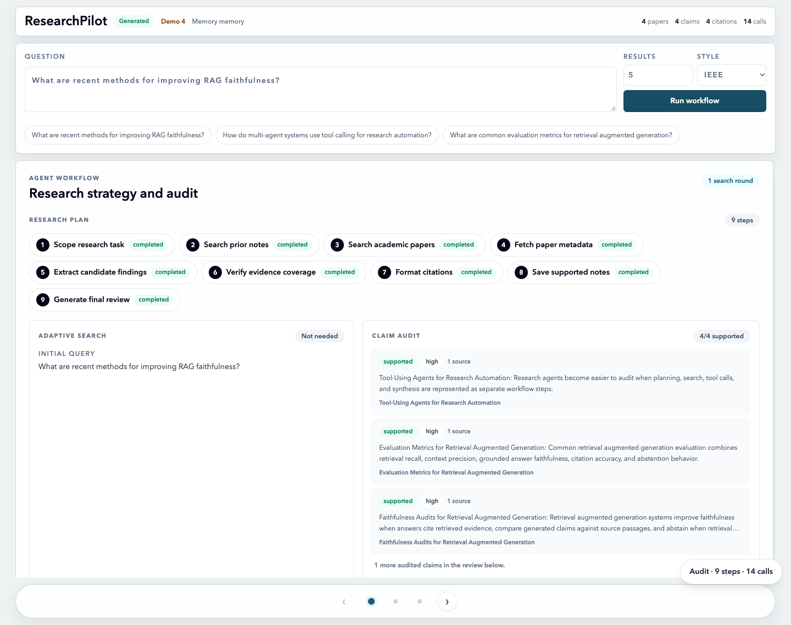
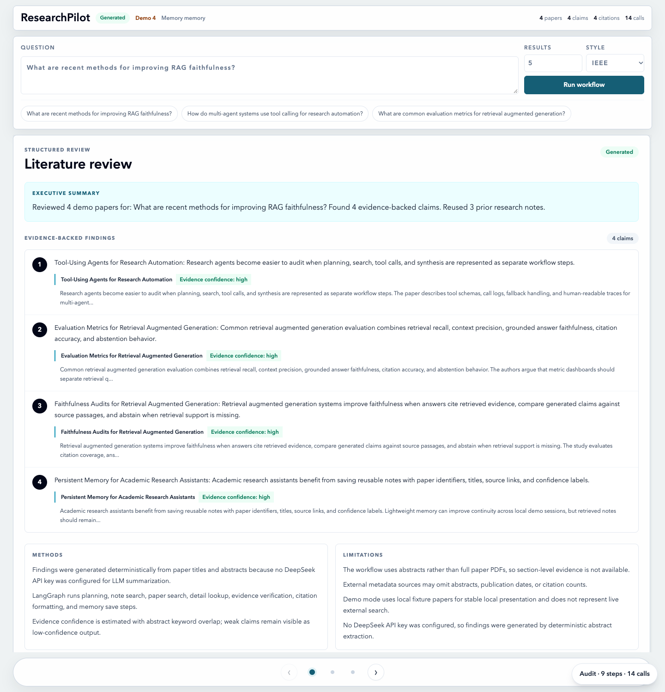
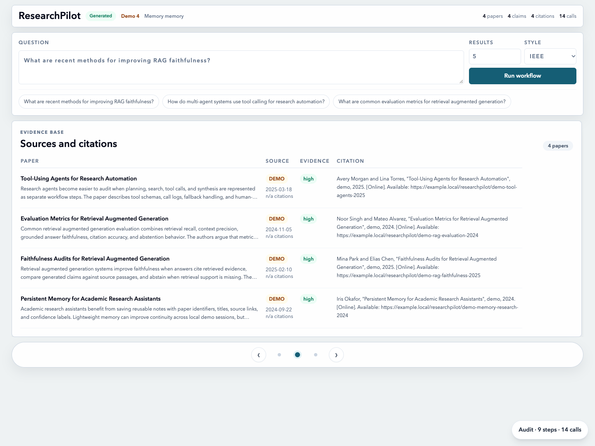
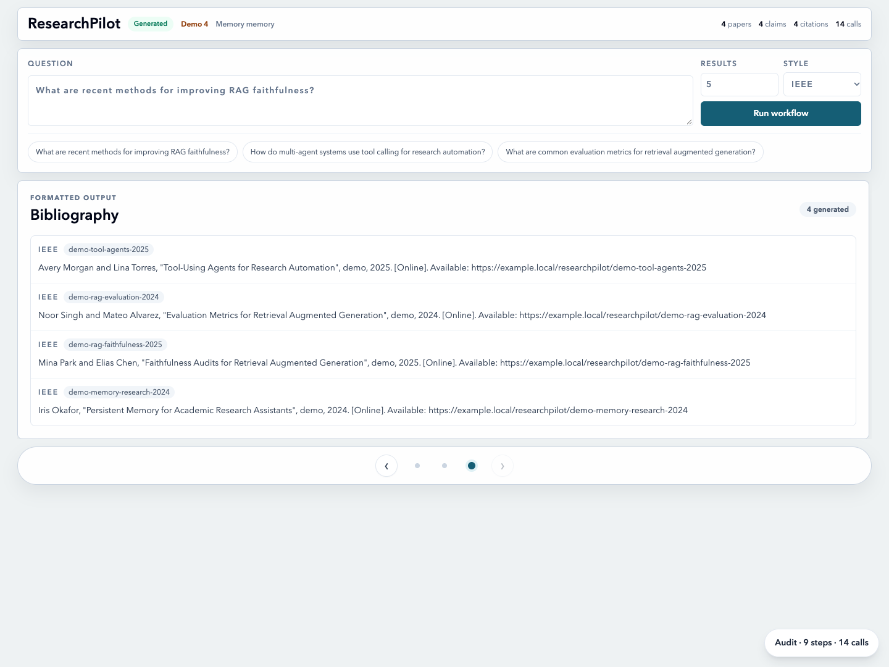
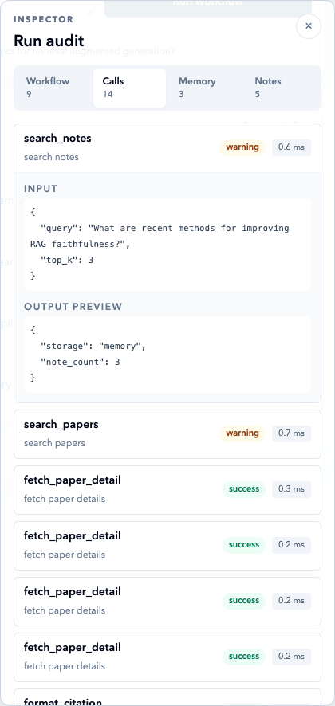
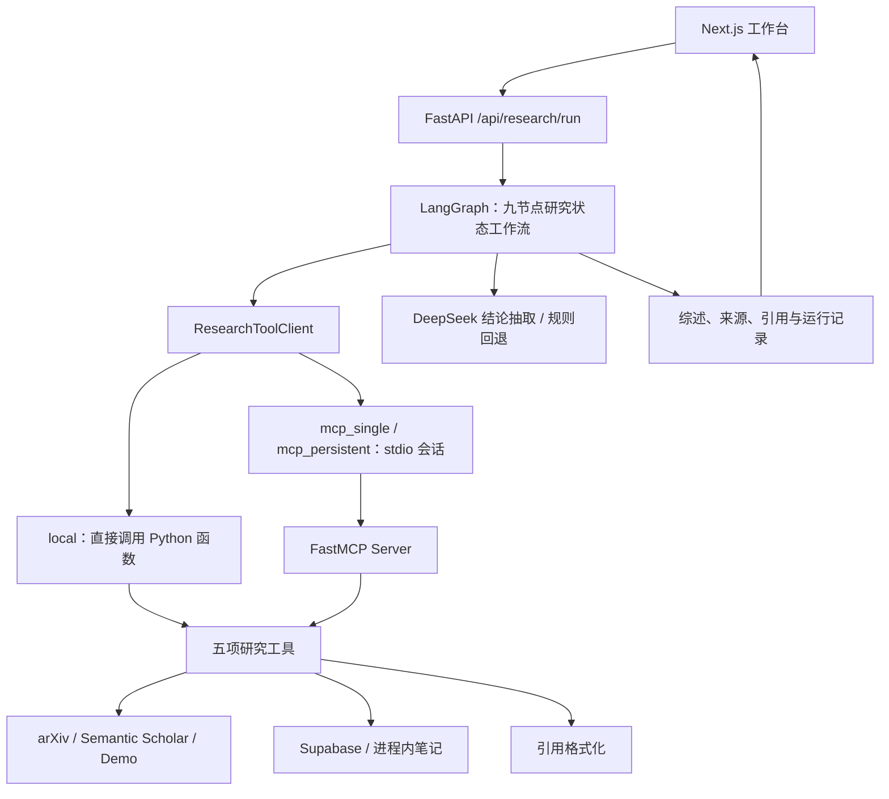

# ResearchPilot

**简体中文** | [English](README.en.md)

[](https://github.com/AZ123IT/ResearchPilot/actions/workflows/ci.yml)


[](LICENSE)

**基于 LangGraph + MCP 的学术研究 Agent 工作流：从一个研究问题出发，完成论文检索、结论抽取、证据关联与引用生成，并完整记录每一步的工具调用与降级路径。**

输入研究问题，ResearchPilot 会检索 arXiv / Semantic Scholar，用 DeepSeek 从摘要中抽取候选结论，把每条结论关联到来源论文与摘要片段，生成 IEEE / APA / BibTeX 引用，并把运行过程（步骤、工具调用、耗时、告警、回退）完整展示在 Next.js 工作台中。

[界面预览](#界面预览) · [系统架构](#系统架构) · [本地运行](#本地运行) · [架构详解](docs/ARCHITECTURE.md) · [验证记录](docs/VALIDATION.md)

## 核心特性

- **9 节点 LangGraph 状态工作流**：任务规划 → 笔记检索 → 论文搜索 → 元数据获取 → 结论抽取 → 证据校验 → 引用格式化 → 笔记保存 → 综述生成；检索结果不足时自动追加一轮 adaptive search。
- **Research MCP Server**：基于 MCP Python SDK / FastMCP 封装 `search_papers`、`fetch_paper_detail`、`search_notes`、`save_to_notes`、`format_citation` 五项工具；后端通过统一适配层支持 **本地直调 / 单次 MCP stdio / 持久 MCP session** 三种执行模式。
- **多源检索与证据链**：arXiv 主题词字段化查询 + 相关度排序，结果不足时补充 Semantic Scholar；每条结论关联来源论文、摘要片段与匹配等级。
- **结构化 LLM 输出**：DeepSeek 使用 JSON 输出模式抽取结论，非 JSON 响应自动清洗（编号、Markdown、引导语）。
- **可观测与降级**：step trace、tool call logs、run audit、warnings；外部检索缓存、DeepSeek 失败时确定性回退、MCP 失败时本地回退、Supabase 不可用时内存笔记存储。
- **测试与 CI**：39 项 pytest 覆盖工作流路由、工具调用、解析与各条降级路径；GitHub Actions 运行 pytest、TypeScript 类型检查与 Next.js 生产构建。

## 界面预览

以下截图来自 **Demo 模式**（内置样例论文、规则式摘要提取，无需任何 API 密钥），用于展示交互与执行流程。



<details>
<summary>展开查看：综述、论文来源、参考文献与工具调用审计</summary>

### 结构化综述

结论旁展示来源摘要与匹配等级，方法区说明本次使用的是模型抽取还是规则回退。



### 论文来源



### 参考文献



### 工具调用审计

可展开单次调用的输入、输出预览、耗时和状态，告警与回退信息完整保留。



</details>

## 系统架构



### 关键设计

| 设计重点 | 实现与取舍 | 源码入口 |
| --- | --- | --- |
| 显式工作流 | 九个节点共享研究状态，流程由代码控制；adaptive search 在搜索节点内部条件触发，最多一轮，避免无限循环 | [graph.py](backend/app/agent/graph.py)、[nodes.py](backend/app/agent/nodes.py) |
| 编排与工具解耦 | 同一工具接口支持本地函数、单次 stdio、持久 MCP 会话；持久模式通过后台事件循环和队列执行调用 | [client.py](backend/app/mcp_client/client.py)、[server.py](mcp_server/server.py) |
| 检索相关性 | 从问题中提取主题词构造 `all:term AND all:term` 查询并按相关度排序，无结果时放宽为 OR；补搜同样只用主题词 | [arxiv_client.py](mcp_server/clients/arxiv_client.py)、[search_papers.py](mcp_server/tools/search_papers.py) |
| 可解释的降级 | 检索失败读缓存、模型失败走规则抽取、MCP 失败回退本地工具，并全部以告警形式返回 | [search_papers.py](mcp_server/tools/search_papers.py)、[nodes.py](backend/app/agent/nodes.py) |
| 输出可核对 | 结论关联论文与摘要片段，按关键词覆盖率给出 high / medium / low 匹配等级，低匹配结论保留并标注 | [verification_service.py](backend/app/services/verification_service.py) |

### MCP 工具执行模式

| 模式 | 执行方式 | 适用场景 |
| --- | --- | --- |
| `local`（默认） | 直接调用工具函数，不经过 MCP 协议 | 本地开发与测试 |
| `mcp_single` | 每次工具调用启动 stdio 服务并初始化会话 | 验证完整协议链路 |
| `mcp_persistent` | 复用 MCP 服务进程和会话，串行执行调用 | 减少重复启动开销 |

## 本地运行

需要 Python 3.12+、Node.js 20+，以及 Bash 环境（macOS / Linux；Windows 可使用 WSL）。

```bash
git clone https://github.com/AZ123IT/ResearchPilot.git
cd ResearchPilot
python3 -m venv .venv
.venv/bin/python -m pip install -r backend/requirements.txt -r mcp_server/requirements.txt
cd frontend
npm install
cd ..
```

### 无密钥 Demo

终端一（项目根目录）。以下命令禁用本地 `.env` 并清空可选凭据，确保只使用内置样例：

```bash
PYTHON_DOTENV_DISABLED=1 DEEPSEEK_API_KEY= SUPABASE_URL= SUPABASE_SERVICE_ROLE_KEY= \
RESEARCH_TOOL_CLIENT_MODE=local RESEARCHPILOT_DEMO_MODE=true scripts/run_backend.sh
```

终端二（项目根目录）：

```bash
scripts/run_frontend.sh
```

打开 [研究工作台](http://127.0.0.1:3000/research) 或 [API 文档](http://127.0.0.1:8000/docs)，示例问题：`What are recent methods for improving RAG faithfulness?`

### 接入真实检索与模型

复制 [.env.example](.env.example) 为 `.env`，设置 `RESEARCHPILOT_DEMO_MODE=false`，按需填写 `DEEPSEEK_API_KEY`，再用 `scripts/run_backend.sh` 重启后端。arXiv 检索无需密钥；未配置模型时自动使用规则式摘要抽取。

| 配置 | 用途 |
| --- | --- |
| `DEEPSEEK_API_KEY`、`DEEPSEEK_BASE_URL`、`DEEPSEEK_MODEL` | 可选，模型结论抽取（输入前五篇论文的标题与摘要） |
| `SEMANTIC_SCHOLAR_API_KEY` | 可选，Semantic Scholar 凭据 |
| `SUPABASE_URL`、`SUPABASE_SERVICE_ROLE_KEY` | 可选，持久笔记存储；使用前执行 [schema.sql](supabase/schema.sql) |
| `RESEARCH_TOOL_CLIENT_MODE` | `local`、`mcp_single` 或 `mcp_persistent` |
| `MCP_FALLBACK_TO_LOCAL` | MCP 失败时是否回退本地工具；验证真实 MCP 链路时设为 `false` |
| `NEXT_PUBLIC_API_BASE_URL` | 前端 API 地址，默认 `http://127.0.0.1:8000` |

MCP Server 也可独立启动：`scripts/run_mcp_server.sh`。后端在 MCP 模式下会自行拉起服务进程，完整配置见 [架构详解](docs/ARCHITECTURE.md#mcp-会话与工具边界)。

## 测试

```bash
scripts/test_all.sh
```

运行全部 pytest 与前端 TypeScript 类型检查；CI 额外执行 Next.js 生产构建。测试覆盖工作流路由、API 响应结构、arXiv 查询构造、LLM 输出解析、引用格式、摘要匹配、搜索缓存、三种工具模式及各条回退分支。外部服务在测试中均以 mock 替代，详见 [验证记录](docs/VALIDATION.md)。

## 项目结构

```text
ResearchPilot/
├── backend/
│   ├── app/agent/          # LangGraph 状态、节点与图定义
│   ├── app/mcp_client/     # 工具适配层：local / mcp_single / mcp_persistent
│   ├── app/llm/            # DeepSeek 客户端与结构化输出解析
│   ├── app/services/       # 证据校验、引用与笔记服务
│   └── tests/
├── mcp_server/
│   ├── server.py           # FastMCP 工具注册入口
│   ├── tools/              # 五项研究工具实现
│   ├── clients/            # arXiv / Semantic Scholar 客户端
│   └── tests/
├── frontend/               # Next.js + TypeScript + Tailwind 工作台
├── supabase/schema.sql     # 笔记表结构
└── docs/                   # 架构、演示、验证与设计问答
```

## 技术栈

| 层级 | 技术 |
| --- | --- |
| 前端 | Next.js 15、React 19、TypeScript、Tailwind CSS |
| API 与编排 | FastAPI、Pydantic、LangGraph |
| 工具协议 | MCP Python SDK / FastMCP、httpx |
| 模型与存储 | DeepSeek（OpenAI 兼容接口）、Supabase PostgreSQL / 内存存储 |
| 质量保障 | pytest、TypeScript typecheck、GitHub Actions |

## 已知局限与后续计划

- **摘要级证据**：当前处理论文摘要而非全文；`high / medium / low` 是关键词覆盖率等级，不是事实正确率，无法识别否定或因果关系。计划引入 NLI / 语义相似度校验，并建立带人工标注的相关性与结论支持度评测集。
- **检索质量**：已改为主题词字段化查询与相关度排序，但尚无语义重排；下一步加入基于 embedding 的重排与相关性过滤，并让补搜由证据不足（而非数量不足）触发。
- **笔记复用**：历史笔记按关键词检索并展示，尚未注入模型上下文；`vector(1536)` 字段为向量检索预留。
- **部署范围**：当前为本地单用户应用，无认证与多租户隔离。

安全提示：不要提交 `.env`，不要向前端暴露服务密钥。启用 DeepSeek 会发送问题与论文标题/摘要；启用 Supabase 会存储笔记。

更多文档：[架构与实现取舍](docs/ARCHITECTURE.md) · [演示与故障排查](docs/DEMO_SCRIPT.md) · [验证记录](docs/VALIDATION.md) · [设计问答](docs/DESIGN_FAQ.md)

## 许可证

本项目基于 [MIT License](LICENSE) 开源。
